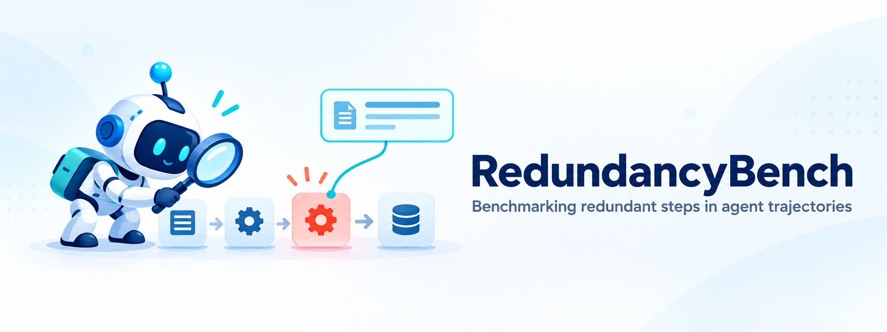
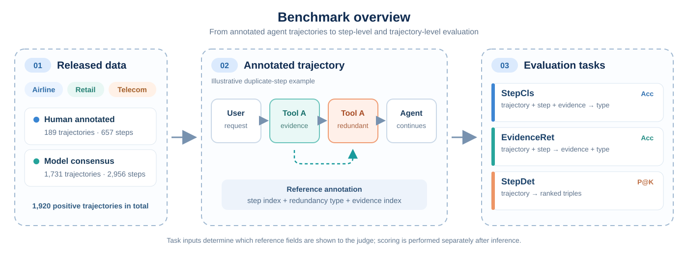

<h1 align="center">
  
</h1>

<p align="center">
  <a href="LICENSE"></a>
  <a href="https://huggingface.co/datasets/redundant-or-necessary/RedundancyBench"></a>
  <a href="https://arxiv.org/pdf/2605.29893"></a>
</p>

> A benchmark for detecting redundant steps in agent trajectories.

## Overview

This repository provides the code and data for [**Redundant or Necessary? A Benchmark for Detecting Redundant Steps in Agent Trajectories**](https://arxiv.org/abs/2605.29893).

RedundancyBench evaluates whether LLMs can identify steps that consume resources while contributing little to task completion. Given an agent trajectory, the goal is to **locate redundant tool interactions**, **classify their redundancy types**, and **retrieve the evidence** supporting each judgment. The benchmark contains **1,920 trajectories** and **3,613 step-level annotations** across three customer-service domains.

<p align="center">
  
</p>

The three tasks progressively remove prior information. All receive the full observable trajectory and domain policy:

| Task | Additional input | Expected output |
| --- | --- | --- |
| **StepCls** (`classify`) | A redundant step and its evidence | Redundancy type |
| **EvidenceRet** (`retrieve`) | A redundant step | Evidence indices and redundancy type |
| **StepDet** (`detect`) | None | Redundant steps, evidence indices, types, and confidence scores |

StepCls and EvidenceRet use one annotated step per request; StepDet uses one complete trajectory. Task prompts and label definitions are provided in [`prompts.py`](redundancybench/LLM_judge/prompts.py).

## Dataset

The data are available in [`data/`](data/), organized into **human-annotated** and **model-consensus** subsets. Trajectories cover the Airline, Retail, and Telecom domains of the [τ-bench](https://github.com/sierra-research/tau-bench) and [τ²-bench](https://github.com/sierra-research/tau2-bench) benchmarks.

| Domain | Human trajectories | Human-labeled steps | Model-consensus trajectories | Model-consensus steps |
| --- | ---: | ---: | ---: | ---: |
| Airline | 38 | 134 | 165 | 483 |
| Retail | 40 | 99 | 412 | 744 |
| Telecom | 111 | 424 | 1,154 | 1,729 |
| **Total** | **189** | **657** | **1,731** | **2,956** |

Each annotation records a redundant step, its type, and supporting evidence in the same trajectory. We distinguish four types:

| Type | Description |
| --- | --- |
| **Duplicated Step** | Repeats information or an operation already covered by earlier valid interactions. |
| **Abnormal Step** | A transient external or tool failure superseded by a later successful retry. |
| **Incorrect Step** | An unjustified action given the request, policy, or information available at that point. |
| **Exploratory Step** | A reasonable search or diagnosis that contributes no necessary information to task completion. |

The model-consensus subset contains trajectories from five generation models, with labels retained when at least two of three annotation models agreed. **These 1,731 trajectories were not individually human-verified.** All released trajectories contain at least one labeled redundant step; StepDet therefore evaluates detection on positive trajectories.

See the [human subset documentation](data/human_annotation/README.md) and [model-consensus subset documentation](data/automated_annotation/README.md) for file formats, record identifiers, and annotation provenance.

## Evaluation

### Setup

Use **Python 3.10+** and an OpenAI-compatible Chat Completions endpoint. No third-party Python packages are required; see [`requirements.txt`](redundancybench/requirements.txt).

```bash
git clone https://github.com/LiangZhu419/RedundancyBench.git
cd RedundancyBench

export OPENAI_API_KEY="your-api-key"
export MODEL_BASE_URL="https://your-endpoint.example/v1"
```

Run all commands below from the repository root.

### Inference

Replace `your-model` with the model ID served by your endpoint:

```bash
python3 -m redundancybench.LLM_judge.run_experiment \
  --model your-model \
  --base-url "$MODEL_BASE_URL"
```

This runs all three tasks on both subsets and all domains: **3,613 StepCls + 3,613 EvidenceRet + 1,920 StepDet = 9,146 requests**. Predictions and raw responses are saved under `results/your-model/`; the runner prints the result path for each task.

For a small trial, add `--limit 1 --output-dir results/trial` to run one request per task. Add `--dry-run` to preview prompts without calling the model.

<details>
<summary>Task selection and inference options</summary>

| Option | Usage |
| --- | --- |
| `--task classify`, `retrieve`, or `detect` | Run a single task. The default is all three. |
| `--dataset human_annotation` or `automated_annotation` | Evaluate one subset. The default is both. |
| `--domain airline`, `retail`, or `telecom` | Evaluate one domain. The default is all three. |
| `--limit N` | Use the first N annotated steps per StepCls/EvidenceRet task, or N trajectories for StepDet. |
| `--resume` | Continue an interrupted run with the same settings. |

The default settings are temperature `0`, an output limit of `32,768` tokens, and the domain policy included in the prompt. StepDet has no prediction-count cap. For endpoints that require `max_completion_tokens`, add `--max-tokens-param max_completion_tokens`.

Use `python3 -m redundancybench.LLM_judge.run_experiment --help` for all options.

</details>

### Scoring

Score the saved predictions with the offline evaluator:

```bash
python3 -m redundancybench.evaluation \
  results/your-model/your-model_classify.json \
  results/your-model/your-model_retrieve.json \
  results/your-model/your-model_detect.json \
  --output results/your-model/evaluation.json
```

Use the paths printed by the runner for your model. A single task file can also be scored on its own. The report contains overall scores and breakdowns by domain and annotation subset. Scoring makes no model requests.

### Metrics

| Task | Metric | Correct prediction |
| --- | --- | --- |
| **StepCls** | Accuracy over all reference steps | The predicted type matches the reference type. |
| **EvidenceRet** | Joint accuracy over all reference steps | Both the type and the complete evidence reference match. |
| **StepDet** | P@1, P@5, P@10, and Avg P@K | The step, evidence, and type all match, with at most one hit per step. |

For trajectory `i`, let `n_i` be the number of returned predictions and `h_i(K)` the number of correct, distinct steps among its first `min(K, n_i)` predictions after ranking by confidence. StepDet averages precision across trajectories:

```text
P_i@K   = h_i(K) / min(K, n_i)
P@K     = mean_i(P_i@K)
Avg P@K = mean(P@1, P@5, P@10)
```

An empty prediction list scores zero. The default cutoffs are `K = 1, 5, 10`; set `--ks` in the scoring command to use other cutoffs.

<details>
<summary>Exact matching and ranking rules</summary>

- Message indices must match the references exactly. Complete pairs in joint evidence may be reordered, but indices within each pair must retain their order.
- Repeated predictions for the same step occupy ranking slots. Only the first prediction with valid confidence is eligible to score; an incorrect type or evidence cannot be corrected by a later prediction for that step.
- Invalid confidence entries occupy non-scoring slots ahead of numeric confidences, following the original experiment protocol. They do not reserve a step against later predictions with valid confidence.
- Failed, truncated, or unparseable replies remain in the evaluation denominator and score zero. The evaluator requires complete result files for the requested run.

</details>

## Repository

```text
assets/                  README figures
data/                    Trajectories and reference annotations
redundancybench/
  LLM_judge/             Task prompts, model inference, and response parsing
  evaluation.py          Offline scoring
  data_loader.py         Dataset loading
  tests/                 Data and metric checks
```

To run the checks: `python3 -m unittest discover -s redundancybench/tests -v`.

## 📖 Reference

> [!IMPORTANT]
> If you find RedundancyBench useful in your research, please consider citing our work:

```bibtex
@article{zhu2026redundant,
  title   = {Redundant or Necessary? A Benchmark for Detecting Redundant Steps in Agent Trajectories},
  author  = {Zhu, Liang and Yang, Bo and Zhou, Zhinuo and Liang, Jiachen and
             Guo, Jiahao and Yin, Yiyang and Han, Xiongwei and Hu, Minyang},
  journal = {arXiv preprint arXiv:2605.29893},
  year    = {2026}
}
```
